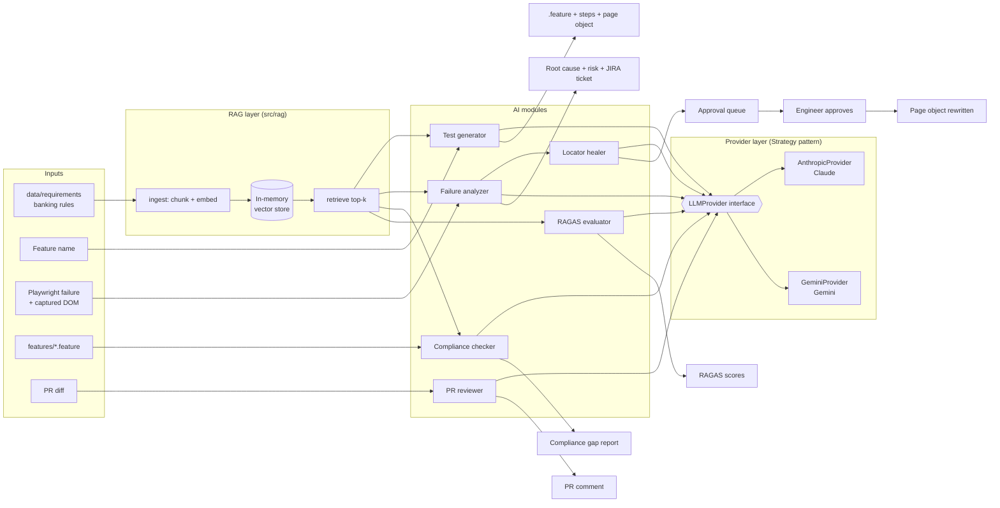

# Banking QA v2: AI-assisted test automation

An AI-assisted test automation framework for retail banking, built on **Playwright**, **Cucumber BDD** and **TypeScript**. An LLM (Claude or Gemini) is grounded in banking requirements through **RAG** (retrieval-augmented generation) and used to:

- **Generate tests:** Gherkin feature files, Cucumber step definitions and Playwright page objects, built from a feature name and the matching requirements (transfer limits, AML thresholds and so on).
- **Heal locators:** when a test fails because a UI element changed, the framework captures the page DOM and suggests a more stable locator with a confidence rating. Nothing changes until an engineer approves it.
- **Analyse failures:** it turns a Playwright failure into a plain-English root cause, a failure classification, a regulatory risk rating and a ready-to-file JIRA ticket.
- **Check compliance:** it maps BDD scenarios against FCA, AML, KYC, GDPR and PCI-DSS requirements and reports the gaps.
- **Review pull requests:** a GitHub Action sends the test-code diff of every PR to the LLM and posts a review comment that flags missing assertions, flaky patterns and fragile locators.
- **Measure RAG quality** with RAGAS metrics.

The LLM layer is **model-agnostic**: one setting in `.env` switches every module between Claude and Gemini, with no change to test logic.

---

## Tech stack

| Area | Tools |
|---|---|
| Language | TypeScript (Node.js 18+) |
| UI and API testing | Playwright (`@playwright/test`) |
| BDD | Cucumber.js (`@cucumber/cucumber`), Gherkin |
| LLM providers | Anthropic Claude (`@anthropic-ai/sdk`), Google Gemini (`@google/genai`) |
| RAG | ChromaDB embedding function (`chromadb`, `chromadb-default-embed`), in-memory vector store |
| CI | GitHub Actions (CI pipeline and AI PR review) |
| Design | Page Object Model, Strategy pattern for LLM providers |

---

## Setup

```bash
git clone https://github.com/<your-username>/banking-qa-v2.git
cd banking-qa-v2
npm install
npx playwright install chromium
```

Create your `.env` from the template:

```bash
cp .env.example .env
```

Then edit `.env`:

| Variable | Purpose |
|---|---|
| `LLM_PROVIDER` | `anthropic` (default) or `gemini` |
| `ANTHROPIC_API_KEY` | Claude API key (when `LLM_PROVIDER=anthropic`) |
| `CLAUDE_MODEL` | Optional model override, e.g. `claude-haiku-5-5` |
| `GEMINI_API_KEY` | Gemini API key (when `LLM_PROVIDER=gemini`) |
| `GEMINI_MODEL` | Optional model override |
| `BASE_URL` / `API_BASE_URL` | The banking app under test |
| `TEST_USERNAME` / `TEST_PASSWORD` | Test account credentials |

`.env` is git-ignored. Never commit real keys.

Banking requirements live in `data/requirements/` (`.txt` / `.md`). They are chunked and embedded automatically the first time a module needs them. No separate database server is required.

---

## Commands

Run `npm start` with no arguments for an interactive menu, or pass a flag:

| Command | What it does |
|---|---|
| `npm start -- --load` | Loads and embeds `data/requirements/` into the vector store and reports chunk counts. |
| `npm start -- --generate "IMPS transfer"` | Retrieves the matching requirements and generates a `.feature` file, step definitions and a page object in `outputs/generated_tests/`. |
| `npm start -- --evaluate` | Runs the RAGAS evaluation over 5 banking questions and saves the scores to `outputs/evaluation/`. |
| `npm start -- --compliance` | Checks every scenario in `features/` against the FCA, AML, KYC, GDPR and PCI-DSS requirements and saves a gap report to `outputs/compliance_reports/`. |
| `npm start -- --analyze "<test name>" "<error>" ["<stack>"] ["<dom.html>"]` | Analyses one failure: root cause, classification, regulatory risk and a JIRA ticket. Pass a DOM file to get a locator heal suggestion. |
| `npm start -- --test ["filter"]` | Runs Playwright, then automatically analyses each failed test (capped by `MAX_AUTO_ANALYSES`, default 10). |
| `npm start -- --heal-review` | Walks through the queued locator fixes. Approve (`y`), reject (`n`) or skip (`s`) each one. Same as `npm run heal:review`. |

Other scripts:

```bash
npm test               # all Playwright tests
npm run test:api       # API tests
npm run test:e2e       # E2E tests (skips the heal demo)
npm run test:bdd       # Cucumber scenarios
npm run typecheck      # tsc --noEmit
npm run review:pr -- --base origin/main   # AI review of your local diff
```

### Try the locator-healing demo

`tests/e2e/heal-demo.e2e.spec.ts` uses a page object (`pages/QuickPayPage.ts`) whose button locator `#pay-now-btn` no longer matches the page. It runs without the banking app.

```bash
npm start -- --test heal-demo   # fails, captures the DOM, queues an AI suggestion
npm run heal:review             # approve it -> QuickPayPage.ts is rewritten
npx playwright test heal-demo   # passes
```

---

## RAGAS evaluation

[RAGAS](https://docs.ragas.io/) is a standard set of metrics for judging a RAG pipeline. This project implements the four core metrics in TypeScript, with the configured LLM acting as the judge (`src/evaluation/ragasEval.ts`):

| Metric | Question it answers |
|---|---|
| **Faithfulness** | Is every claim in the answer supported by the retrieved context? (Measures hallucination.) |
| **Answer relevance** | Does the answer address the question that was asked? |
| **Context precision** | Are the retrieved chunks relevant, with the useful ones ranked first? |
| **Context recall** | Does the retrieved context contain everything needed for the correct answer? Measured against a ground-truth answer where one exists, and reference-free otherwise. |

Each score ranges from 0 to 1. The overall score is the average of the four, and a run **passes** when every average is above **0.90**.

### What the 0.98 score means

The latest run scored **0.981 overall** across 5 banking questions (IMPS limits, AML triggers, KYC documents, GDPR retention, RTGS minimum):

| Faithfulness | Answer relevance | Context precision | Context recall | Overall |
|---|---|---|---|---|
| 1.000 | 1.000 | 0.924 | 1.000 | **0.981** |

In practice:
- The generated answers were fully grounded in the retrieved requirements (faithfulness 1.0), so nothing was invented.
- The retriever found all the information needed (recall 1.0).
- The main area for improvement is **context precision (0.924)**: some retrieved chunks were not relevant to the question. A reranker or a smaller top-k would improve it.

Caveats: the evaluation set is small (5 questions), and 2 of them are scored reference-free. Treat 0.98 as a regression baseline for this requirement set, not a general guarantee.

---

## Architecture



### The AI layer

- **Provider layer** (`src/generators/llmProvider.ts`): every module calls a single `LLMProvider.call()` interface. `AnthropicProvider` and `GeminiProvider` are interchangeable strategies, and `getProvider()` picks one from `LLM_PROVIDER`. Both enforce structured JSON output through a schema, map 429 errors to `QuotaExhaustedError`, and handle refusals and truncated output.
- **RAG** (`src/rag/`): requirement files are split into chunks and embedded. The top-k chunks for each query are inserted into prompts, so generated tests and analyses cite real limits, such as an IMPS limit of £5,000 per transaction and £10,000 per day, and AML review for transfers above £5,000.
- **Test generator** (`src/generators/testGenerator.ts`): produces the feature file, step definitions and page object. It follows the existing `BasePage` and `CustomWorld` conventions and covers boundary values with Scenario Outlines.
- **Locator healer** (`src/heal/`): fixtures capture `page.content()` on failure. The healer trims the DOM, asks for a role, label or test-id locator with a `high`, `medium` or `low` confidence, and queues it. `heal:review` applies a suggestion to `pages/`, `step-definitions/` and `tests/` only after explicit approval.
- **Failure analyzer** (`src/analysis/`): classifies each failure as UI, API, Data, Environment or Timing, rates the regulatory risk, sets a JIRA priority, and saves a JSON report plus JIRA wiki markup.
- **Compliance checker** (`src/compliance/`): has one module per regulation. The LLM compares the scenario names with each requirement and returns the gaps with a risk level and a suggested scenario.
- **PR reviewer** (`src/review/prReviewer.ts` and `.github/workflows/ai-pr-review.yml`): reviews only the test-related paths of the diff. It posts a single comment and updates it on later pushes. It is advisory and never fails the PR.

---

## Project structure

```
.github/workflows/   CI pipeline and AI PR review
data/requirements/   Banking requirements (RAG source)
features/            Gherkin feature files
step-definitions/    Cucumber steps, world and hooks (DOM capture on failure)
pages/               Playwright page objects (Page Object Model)
tests/               Playwright API and E2E specs, fixtures (DOM capture)
src/rag/             Chunking, embedding, retrieval
src/generators/      LLM provider layer and test generator
src/heal/            DOM snapshot, locator healer, approval queue
src/analysis/        Failure analyzer and JIRA formatting
src/compliance/      FCA, AML, KYC, GDPR and PCI-DSS checks
src/evaluation/      RAGAS evaluation
src/review/          AI PR reviewer
main.ts              CLI and interactive menu
```

## CI

- **`ci.yml`**: typecheck, then the API, E2E and BDD test suites.
- **`ai-pr-review.yml`**: runs on every PR. To enable it, add the repository secret `ANTHROPIC_API_KEY` (or `GEMINI_API_KEY` and set the repository variable `LLM_PROVIDER=gemini`).
